# Informe Técnico y Académico: Análisis Exploratorio, Ingeniería de Características y Modelado Estadístico de Alquileres en Moscú

| Metadato del Proyecto | Detalle |
| :--- | :--- |
| **Dataset Analizado** | `data\rentals_clean.csv` (`20,000` filas × `23` columnas) |
| **SHA-256 Verificado (Inmutable)** | `e43378a0de55cdc2320b76f273ef47e1158a41e7fb0d06da0dc34666a5cc1a71` |
| **Variable Objetivo ($Y$)** | `monthly_rent_rub` (Alquiler mensual nominal en rublos rusos, RUB) |
| **Transformación del Objetivo** | $y_{\log} = \ln(1 + \text{monthly\_rent\_rub})$ con retransformación de Duan ($S = 1.003500$) |
| **Experimento MLflow / Run Ganador** | `primer parcial` / `67c728b8f66241dbb22d629e1f7779a9` |
| **Modelo Ganador** | `LinearRegression` (57 predictores transformados + intercepto $b_0 = +10.744228$) |
| **Desempeño Fuera de Tiempo (`Valid` / `Test`)** | $\text{RMSE}_{\log} = 0.0856$ ($R^2 = 0.9749$) en `Valid` $\mid$ $\text{RMSE}_{\log} = 0.0879$ ($R^2 = 0.9731$) en `Test` |
| **Error en Moneda Original (`Valid` / `Test`)** | $\text{RMSE}_{\text{RUB}} = 5,312.92\text{ RUB}$ ($\text{MAPE} = 6.84\%$) $\mid$ $\text{RMSE}_{\text{RUB}} = 5,533.00\text{ RUB}$ ($\text{MAPE} = 7.01\%$) |

---

## 1. Auditoría de Calidad de Datos y Limpieza Inicial (Etapas 01 y 02)

### 1.1. Reglas de la Etapa Previa y Estado del Dataset
El análisis parte del archivo inmutable `data/rentals_clean.csv` ($N = 20,000$ registros y $23$ columnas):
1. **Conservación íntegra de la muestra:** La normalización de texto y coerción de tipos en `01_cleaning.py` registró **0 fallos de coerción** y **0 filas eliminadas**.
2. **Preservación de valores extremos:** No se aplicaron recortes arbitrarios por IQR, percentiles ni distancia de Cook sobre `monthly_rent_rub` ni sobre las variables predictoras, delegando el tratamiento de la asimetría al modelado logarítmico y transformaciones no lineales.
3. **Chequeos de consistencia lógica y estructural:**
   - **Duplicados exactos (todas las columnas o excluyendo `id`):** `0` filas.
   - **Columnas de varianza cero (constantes):** `0` columnas.
   - **Coherencia vertical (`floor > total_floors` o `floor <= 0`):** `0` filas inconsistentes.
   - **Solapamiento espacial exacto:** Solo `1` par de registros (`2` filas) comparte coordenadas `(lat, lon)` idénticas.
   - **Anomalía temporal documentada (`dq_flags`):** Se detectaron **339 filas (1.70% del total)** donde el año de construcción supera al año de publicación del anuncio (`building_year > año(date_posted)`). Estos casos fueron marcados en la columna de auditoría `dq_flags = 'building_year_after_posting'` y concentrados en la partición de entrenamiento (`339` en `train`, `0` en `valid`, `0` en `test`), donde `building_age` se trata mediante imputación en el preprocesador.

### 1.2. Inventario Completo de Variables (23 Columnas)

| Columna | Tipo Pandas | Rol Analítico | Nulos (%) | Únicos | Decisión de Ingeniería | Descripción |
| :--- | :--- | :--- | ---: | ---: | :--- | :--- |
| `id` | `str` | `id` | 0.00% | 20,000 | ❌ Excluir | Identificador secuencial único sin señal predictiva |
| `date_posted` | `str` | `temporal` | 0.00% | 1,945 | ⚠️ Derivar | Fecha ISO (`2021-01-01` a `2026-04-29`); define el split temporal, `t_years` y `building_age` |
| `district` | `str` | `categorical` | 0.00% | 129 | ✅ Target Enc. | Distrito municipal (*raion*) de Moscú |
| `okrug` | `str` | `categorical` | 0.00% | 11 | ❌ Excluir (Redundante) | Distrito administrativo; colinealidad $V = 0.997$ con `district` |
| `lat` | `float64` | `spatial` | 0.00% | 15,985 | ✅ Incluir (`numeric`) | Latitud geográfica en grados decimales |
| `lon` | `float64` | `spatial` | 0.00% | 16,678 | ✅ Incluir (`numeric`) | Longitud geográfica en grados decimales |
| `total_area` | `float64` | `numeric_continuous` | 0.00% | 695 | ✅ Incluir (`spline`) | Superficie total del inmueble en $\text{m}^2$ |
| `rooms` | `int64` | `numeric_discrete` | 0.00% | 4 | ✅ Incluir (`numeric`) | Cantidad de habitaciones / ambientes (1 a 4) |
| `floor` | `int64` | `numeric_discrete` | 0.00% | 22 | ⚠️ Derivar (`floor_ratio`) | Piso de la unidad; se sustituye por `floor / total_floors` |
| `total_floors` | `int64` | `numeric_discrete` | 0.00% | 5 | ✅ Incluir (`numeric`) | Total de pisos del edificio (5, 9, 12, 17, 22) |
| `building_year` | `int64` | `numeric_discrete` | 0.00% | 90 | ⚠️ Derivar (`building_age`) | Año de construcción (1935 a 2024) |
| `building_type` | `str` | `categorical` | 0.00% | 6 | ✅ Incluir (`onehot`) | Tipología constructiva (`brick` como categoría base) |
| `renovation` | `str` | `categorical` | 0.00% | 4 | ✅ Incluir (`onehot`) | Estado interior (`cosmetic` como categoría base) |
| `furnished` | `bool` | `boolean` | 0.00% | 2 | ✅ Incluir (`numeric`) | Indicador binario de amoblamiento |
| `pets_allowed` | `bool` | `boolean` | 0.00% | 2 | ✅ Incluir (`numeric`) | Indicador binario de admisión de mascotas |
| `deposit_months` | `int64` | `numeric_discrete` | 0.00% | 3 | ✅ Incluir (`numeric`) | Meses de depósito en garantía (0, 1 o 2) |
| `metro_station` | `str` | `categorical` | 0.00% | 104 | ❌ Excluir (Inconsistente) | Estación reportada; aparece dispersa en los 11 *okrugs* |
| `metro_line` | `str` | `categorical` | 0.00% | 12 | ❌ Excluir (Inconsistente) | Línea de metro; inconsistencia geográfica asociada |
| `metro_distance_min` | `int64` | `numeric_continuous` | 0.00% | 852 | ✅ Incluir (`log+spline`) | Distancia al metro (0 a 966); tratada mediante log-spline + PCA |
| `to_center_km` | `float64` | `numeric_continuous` | 0.00% | 4,266 | ✅ Incluir (`spline`) | Distancia en línea recta al centro de Moscú (km) |
| `monthly_rent_rub` | `int64` | `target` | 0.00% | 1,576 | 🎯 **Objetivo ($Y$)** | Alquiler mensual en RUB |
| `rent_per_sqm` | `int64` | `leakage_candidate` | 0.00% | 2,335 | ❌ Excluir (Fuga 100%) | Equivale a `monthly_rent_rub / total_area` |
| `dq_flags` | `str` | `audit` | 98.31% | 1 | ❌ Excluir (Auditoría) | Bandera de control generada en la etapa 01 |

---

## 2. Análisis Univariado Exhaustivo

### 2.1. Variable Objetivo (`monthly_rent_rub`) y Justificación de `log1p`
- **Tendencia central y dispersión paramétrica:** Media de **52,432.86 RUB** y desviación estándar de **30,003.24 RUB**, lo que arroja un coeficiente de variación elevado ($\text{CV} = 0.572$).
- **Estadísticos de orden (no paramétricos):** Rango desde **6,800 RUB** hasta **300,700 RUB** ($P_{01} = 11,600$; $P_{05} = 17,300$; $P_{25} = 32,800$; **Mediana = 45,800 RUB**; $P_{75} = 64,400$; $P_{95} = 109,705$; $P_{99} = 161,102$), con rango intercuartílico $\text{IQR} = 31,600\text{ RUB}$ y desviación absoluta mediana $\text{MAD} = 15,000\text{ RUB}$.
- **Morfología distribucional y valores extremos:** Fuerte asimetría positiva ($\text{skewness} = 1.820$) y comportamiento leptocúrtico ($\text{kurtosis} = 5.565$), rechazando normalidad ($p = 0.00$). Bajo el criterio de Tukey se contabilizan **936 outliers moderados** ($> 1.5 \times \text{IQR}$, el **4.68%** de la muestra) y **212 outliers severos** ($> 3.0 \times \text{IQR}$).
- **Estabilización mediante $y_{\log} = \ln(1 + y)$:** Al aplicar `log1p`, la asimetría se reduce drásticamente a **-0.136** y la curtosis a **0.216**, logrando simetría gaussiana y homocedasticidad condicional.

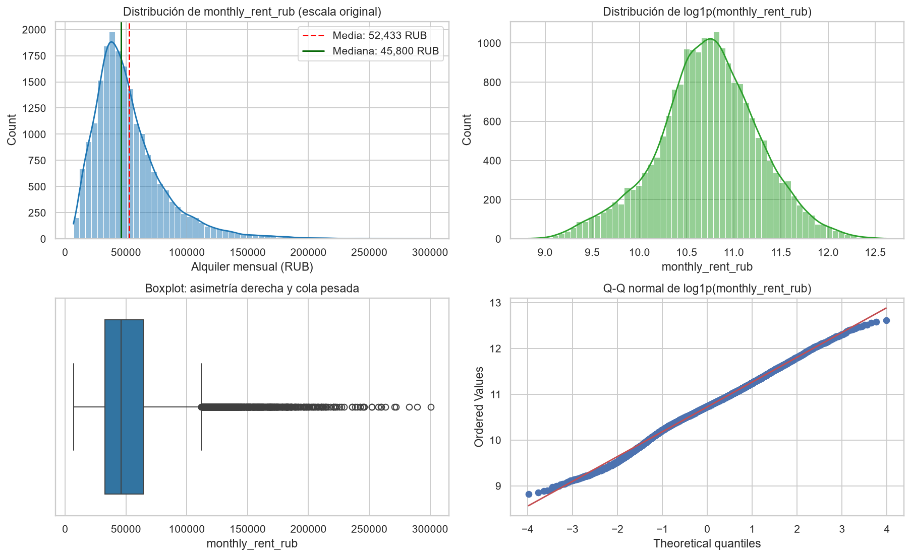

### 2.2. Estadística Descriptiva de Variables Numéricas (Paramétrica y No Paramétrica)

| Variable | Media | DE | CV | Mín | P01 | P05 | P25 | Mediana | P75 | P95 | P99 | Máx | IQR | MAD | Skew | Kurt | Normal $p$ | Outliers 1.5×IQR (%) | Outliers 3×IQR |
| :--- | ---: | ---: | ---: | ---: | ---: | ---: | ---: | ---: | ---: | ---: | ---: | ---: | ---: | ---: | ---: | ---: | ---: | ---: | ---: |
| `monthly_rent_rub` | 52,432.86 | 30,003.24 | 0.572 | 6,800.0 | 11,600.0 | 17,300.0 | 32,800.0 | 45,800.0 | 64,400.0 | 109,705.0 | 161,102.0 | 300,700.0 | 31,600.0 | 15,000.0 | 1.820 | 5.565 | 0.00e+00 | 936 (4.68%) | 212 |
| `rent_per_sqm` | 945.46 | 480.54 | 0.508 | 148.0 | 246.0 | 329.0 | 644.0 | 845.0 | 1,135.0 | 1,873.0 | 2,680.1 | 4,264.0 | 491.0 | 234.0 | 1.593 | 4.020 | 0.00e+00 | 1,001 (5.00%) | 233 |
| `total_area` | 55.39 | 12.74 | 0.230 | 22.1 | 33.2 | 37.7 | 45.7 | 53.8 | 63.3 | 79.3 | 89.2 | 104.6 | 17.6 | 8.7 | 0.577 | -0.087 | 6.36e-54 | 174 (0.87%) | 0 |
| `rooms` | 1.79 | 0.87 | 0.482 | 1.0 | 1.0 | 1.0 | 1.0 | 2.0 | 2.0 | 3.0 | 4.0 | 4.0 | 1.0 | 1.0 | 0.847 | -0.115 | 1.34e-107 | 945 (4.72%) | 0 |
| `floor` | 6.61 | 4.83 | 0.731 | 1.0 | 1.0 | 1.0 | 3.0 | 5.0 | 9.0 | 17.0 | 21.0 | 22.0 | 6.0 | 3.0 | 1.074 | 0.619 | 1.51e-161 | 570 (2.85%) | 0 |
| `total_floors` | 12.19 | 5.69 | 0.467 | 5.0 | 5.0 | 5.0 | 9.0 | 9.0 | 17.0 | 22.0 | 22.0 | 22.0 | 8.0 | 4.0 | 0.437 | -1.034 | 3.67e-290 | 0 (0.00%) | 0 |
| `building_year` | 1987.82 | 22.50 | 0.011 | 1935.0 | 1939.0 | 1954.0 | 1968.0 | 1988.0 | 2008.0 | 2021.0 | 2024.0 | 2024.0 | 40.0 | 20.0 | -0.101 | -1.141 | 0.00e+00 | 0 (0.00%) | 0 |
| `deposit_months` | 1.10 | 0.54 | 0.491 | 0.0 | 0.0 | 0.0 | 1.0 | 1.0 | 1.0 | 2.0 | 2.0 | 2.0 | 0.0 | 0.0 | 0.072 | 0.275 | 1.64e-04 | 6,053 (30.27%) | 6,053 |
| `metro_distance_min` | 152.39 | 167.80 | 1.101 | 0.0 | 2.0 | 6.0 | 33.0 | 103.0 | 198.0 | 543.0 | 776.0 | 966.0 | 165.0 | 77.0 | 1.963 | 4.039 | 0.00e+00 | 1,416 (7.08%) | 488 |
| `to_center_km` | 16.36 | 12.80 | 0.782 | 0.02 | 1.67 | 3.38 | 9.04 | 13.23 | 18.03 | 46.33 | 65.95 | 71.06 | 8.99 | 4.40 | 2.121 | 4.828 | 0.00e+00 | 1,905 (9.53%) | 1,102 |
| `lat` | 55.713 | 0.144 | 0.003 | 55.230 | 55.271 | 55.405 | 55.636 | 55.740 | 55.818 | 55.888 | 55.956 | 56.013 | 0.182 | 0.090 | -0.980 | 0.908 | 1.60e-138 | 672 (3.36%) | 0 |
| `lon` | 37.542 | 0.181 | 0.005 | 36.702 | 36.926 | 37.206 | 37.465 | 37.564 | 37.652 | 37.805 | 37.861 | 37.908 | 0.187 | 0.093 | -1.224 | 2.969 | 1.15e-248 | 743 (3.71%) | 161 |

**Hallazgos univariados clave en predictores numéricos:**
1. **`total_area`:** Distribución unimodal ligeramente asimétrica a la derecha ($	ext{mediana} = 53.8	ext{ m}^2$, $	ext{IQR} = 17.6	ext{ m}^2$), acotada entre $22.1$ y $104.6	ext{ m}^2$ sin outliers extremos ($0$ casos a $3	imes	ext{IQR}$).
2. **`to_center_km` y `metro_distance_min`:** Fuertemente sesgadas a la derecha ($	ext{skewness} > 1.96$) con colas largas hacia la periferia de Nueva Moscú (hasta $71.06	ext{ km}$ y $966	ext{ min}$).
3. **`building_year`:** Distribución bimodal ($Kurt = -1.141$) que refleja dos grandes etapas urbanísticas: edificación soviética (pico en 1965–1975) y desarrollos modernos post-2000.
4. **`total_floors` y `deposit_months`:** Variables discretizadas en escalones arquitectónicos estándar (`5, 9, 12, 17, 22` plantas) y contractuales (`1` mes de depósito concentra casi el 70% de los anuncios, provocando que $	ext{IQR} = 0$ y que cualquier valor $0$ o $2$ figure técnicamente como outlier de Tukey en el 30.27% de las filas).

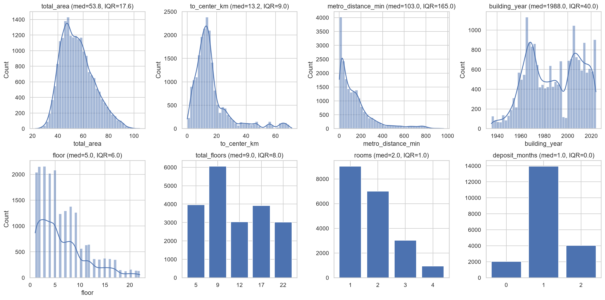

### 2.3. Variables Categóricas y Booleanas (Cardinalidad, Frecuencias y Rareza)

| Variable | Tipo | Filas Válidas | % Nulos | Únicos | Categoría Modal (Top) | % Top | Categoría Menos Frecuente | % Mín | Categorías Raras (<1%) |
| :--- | :--- | ---: | ---: | ---: | :--- | ---: | :--- | ---: | ---: |
| `okrug` | `str` | 20,000 | 0.00% | 11 | `SVAO` | 12.94% | `ZelAO` | 0.69% | 1 |
| `district` | `str` | 20,000 | 0.00% | 129 | `Dorogomilovo` | 0.95% | `Ivanovskoye` | 0.61% | 129 |
| `building_type` | `str` | 20,000 | 0.00% | 6 | `panel` | 24.84% | `stalin` | 4.88% | 0 |
| `renovation` | `str` | 20,000 | 0.00% | 4 | `cosmetic` | 45.17% | `no_renovation` | 9.93% | 0 |
| `furnished` | `bool` | 20,000 | 0.00% | 2 | `True` | 70.22% | `False` | 29.79% | 0 |
| `pets_allowed` | `bool` | 20,000 | 0.00% | 2 | `False` | 69.72% | `True` | 30.29% | 0 |
| `metro_line` | `str` | 20,000 | 0.00% | 12 | `Kaluzhsko-Rizhskaya` | 14.14% | `MCC` | 1.47% | 0 |
| `metro_station` | `str` | 20,000 | 0.00% | 104 | `Sviblovo` | 1.93% | `Tekstilshchiki` | 0.54% | 73 |
| `dq_flags` | `str` | 339 | 98.31% | 1 | `building_year_after_posting` | 100.00% | `building_year_after_posting` | 100.00% | 0 |

---

## 3. Análisis Bivariado (Relaciones Predictoras vs. Objetivo y Entre Pares)

### 3.1. Correlaciones Paramétricas (Pearson $r$) y Monótonas (Spearman $\rho$) con `monthly_rent_rub`

| Variable | Pearson ($r$) | Spearman ($\rho$) | $ert \rhoert $ Spearman | Lectura Analítica |
| :--- | ---: | ---: | ---: | :--- |
| `rent_per_sqm` | +0.8933 | +0.8826 | 0.8826 | 🚨 **Fuga de datos directa** (`monthly_rent_rub / total_area`) |
| `to_center_km` | -0.5314 | -0.6332 | 0.6332 | **Mayor predictor espacial continuo**; relación monótona decreciente no lineal ($ert \rhoert  > ert rert $) |
| `metro_distance_min` | -0.5123 | -0.6329 | 0.6329 | Fuerte caída no lineal; alta colinealidad con `to_center_km` ($r = 0.904$) |
| `total_area` | +0.4108 | +0.4376 | 0.4376 | Principal determinante físico de tamaño del inmueble |
| `rooms` | +0.3583 | +0.3785 | 0.3785 | Asociado al tamaño; fuertemente correlacionado con `total_area` ($r = 0.88$) |
| `lat` | +0.2738 | +0.2463 | 0.2463 | Gradiente espacial Norte-Sur (expansión de Nueva Moscú hacia el suroeste más económico) |
| `lon` | +0.2225 | +0.1926 | 0.1926 | Gradiente espacial Este-Oeste |
| `building_year` | +0.0503 | +0.0663 | 0.0663 | Señal marginal bruta débil por sí sola (conviven edificios `stalin` céntricos caros y periferia nueva) |
| `floor` | -0.0055 | -0.0047 | 0.0047 | Correlación marginal nula; correlaciona con `total_floors` ($r = 0.59$) |
| `deposit_months` | +0.0011 | +0.0037 | 0.0037 | Sin asociación marginal lineal con el precio |
| `total_floors` | -0.0024 | +0.0002 | 0.0002 | Sin asociación marginal directa |

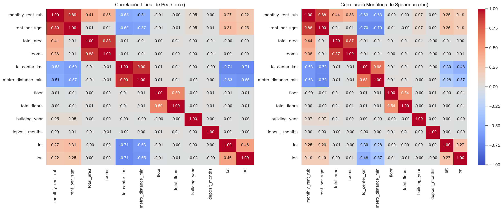

### 3.2. Interacciones Bivariadas Clave (`total_area`, `rooms` y `to_center_km`)
El análisis gráfico conjunto revela dos fenómenos fundamentales para la especificación del modelo:
1. **Cono heterocedástico en escala original (`monthly_rent_rub` vs `total_area`):** La dispersión del precio en rublos se abre en abanico a medida que aumenta el área y el número de habitaciones (`rooms` segmenta verticalmente los bloques de 1, 2, 3 y 4 ambientes).
2. **Curvatura convexa en `log(alquiler)` vs `to_center_km`:** Aún después de transformar el alquiler a escala logarítmica, la caída del precio con la distancia al centro presenta una pendiente muy pronunciada en los primeros 15 km (anillo central e intermedio), un aplanamiento entre 20 y 40 km y escalones discretos entre 45 y 70 km (satélites de Nueva Moscú), justificando el uso de **bases de splines cúbicos** en lugar de un único término lineal.

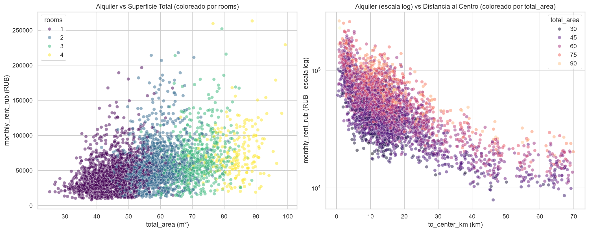

### 3.3. Asociación Categórica → Objetivo (Prueba de Kruskal-Wallis y Tamaño de Efecto $\eta^2$)

| Variable Categórica | Categorías Únicas | Estadístico $H$ (Kruskal-Wallis) | Valor $p$ | Eta Cuadrado ($\eta^2$) | Poder Explicativo Marginal |
| :--- | ---: | ---: | ---: | ---: | :--- |
| `district` | 129 | 12,289.91 | 0.00e+00 | **0.6044** | Explica por sí sola el **60.44%** de la varianza del alquiler |
| `okrug` | 11 | 9,853.63 | 0.00e+00 | **0.4916** | Agrupación macro-administrativa (explica el 49.16%) |
| `renovation` | 4 | 881.52 | 9.04e-191 | **0.0427** | Orden estricto de medianas: `designer` > `euro` > `cosmetic` > `no_renovation` |
| `metro_station` | 104 | 593.91 | 4.47e-70 | **0.0426** | Señal espuria/contaminada por mala asignación geográfica |
| `building_type` | 6 | 671.05 | 8.93e-143 | **0.0289** | Orden de medianas: `stalin` > `monolith` > `brick` > `modern_panel` > `panel` > `khrushchev` |
| `metro_line` | 12 | 74.99 | 1.36e-11 | **0.0084** | Señal débil e inconsistente geográficamente |
| `furnished` | 2 | 90.49 | 1.86e-21 | **0.0034** | Prima positiva significativa para unidades amobladas (`True`) |
| `pets_allowed` | 2 | 10.44 | 1.24e-03 | **0.0005** | Ligero descuento en unidades que admiten mascotas (`True`) |

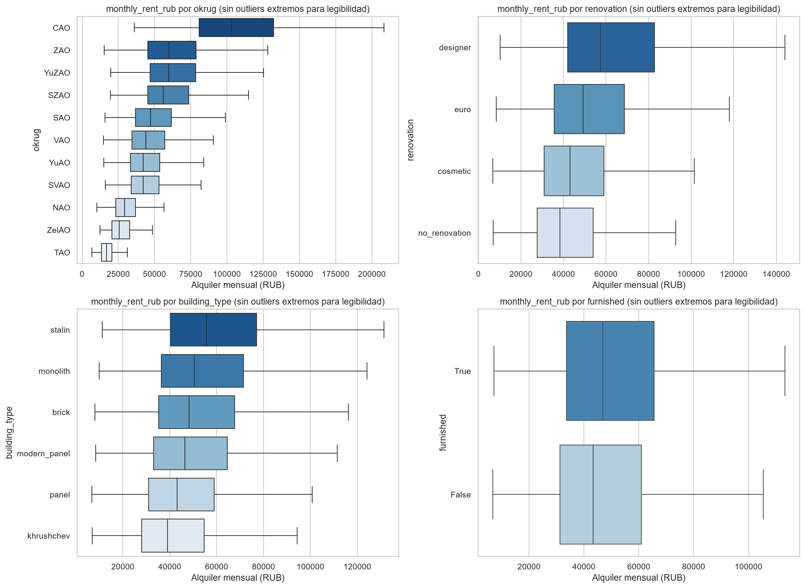

### 3.4. Asociación entre Variables Categóricas (V de Cramér Corregida)

| Variable | `okrug` | `district` | `building_type` | `renovation` |
| :--- | ---: | ---: | ---: | ---: |
| `okrug` | 1.0000 | **0.9970** | 0.0000 | 0.0083 |
| `district` | **0.9970** | 1.0000 | 0.0000 | 0.0000 |
| `building_type` | 0.0000 | 0.0000 | 1.0000 | 0.0000 |
| `renovation` | 0.0083 | 0.0000 | 0.0000 | 1.0000 |

- **Conclusión de colinealidad categórica:** Dado que cada `district` (*raion*) pertenece jerárquicamente a un `okrug` ($V = 0.9970$) y `district` posee mayor poder explicativo ($\eta^2 = 0.6044$ vs $0.4916$), se conserva `district` y se descarta `okrug`. Asimismo, `building_type` y `renovation` son ortogonales entre sí y respecto a la ubicación ($V \approx 0$), aportando señal limpia e independiente.

---

## 4. Análisis Multivariado, Diagnóstico de Fuga y Preprocesamiento (Etapa 03)

### 4.1. Diagnóstico Crítico de Fuga de Datos (`rent_per_sqm`) y Anomalía de Metro (`metro_*`)
1. **Evidencia empírica de Data Leakage en `rent_per_sqm`:** Al graficar `rent_per_sqm` contra el cociente `monthly_rent_rub / total_area`, el **100.0% de los 20,000 registros** cae sobre la recta identidad $y = x$ (salvo redondeo entero $\pm 2\%$). Incluirla introduciría el target en el vector de predictores.
2. **Inconsistencia espacial en `metro_station` y `metro_line`:** Cada estación aparece asignada en una mediana de **11 de los 11 `okrug`** de Moscú. Por su parte, `metro_distance_min` alcanza los **966 minutos** (con el **45.0%** de la muestra superando los 120 minutos) y presenta una correlación de $r = 0.904$ con `to_center_km`. Se excluyen `metro_station` y `metro_line`, pero se rescata la señal no lineal de `metro_distance_min` mediante una transformación logarítmica seguida de *splines* y PCA (`include_metro_distance = True`), cuya ganancia se demuestra en el estudio de ablación.

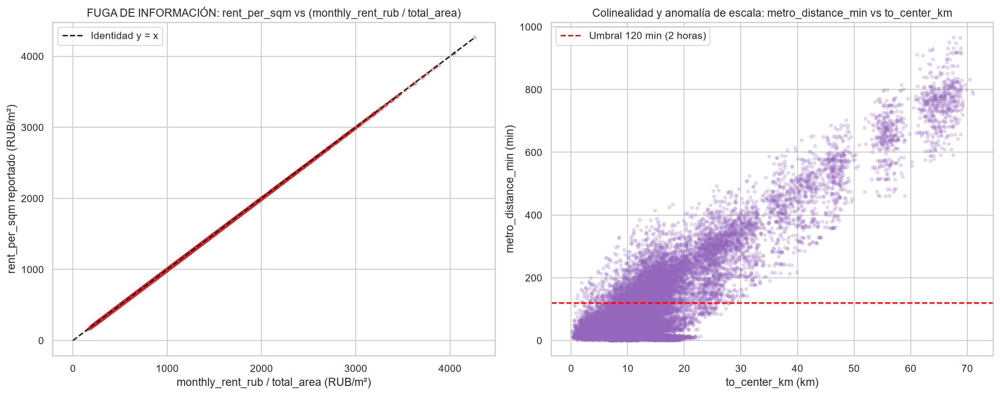

### 4.2. Estructura Espacial y Temporal del Mercado de Moscú
- **Estructura espacial monocéntrica (`08_spatial_distribution.png`):** Los precios exhiben un núcleo de alta renta en el centro histórico (`lat` $\approx 55.75$, `lon` $\approx 37.62$, con $\log_{10}(y) > 5.2$) que decae radialmente hacia la periferia y presenta cúmulos desconectados hacia el suroeste correspondientes a los nuevos distritos (`NAO` / `TAO`) y al enclave noroeste de Zelenograd (`ZelAO`).
- **Dinámica temporal e inflación (`07_temporal_trends.png`):** Entre enero de 2021 y abril de 2026 se observa una deriva alcista sostenida (inflación nominal en rublos), mientras que la distribución intra-anual por mes (meses 1 a 12) muestra cajas prácticamente idénticas, confirmando que el fenómeno dominante es la tendencia secular/macroeconómica y no la estacionalidad mensual.

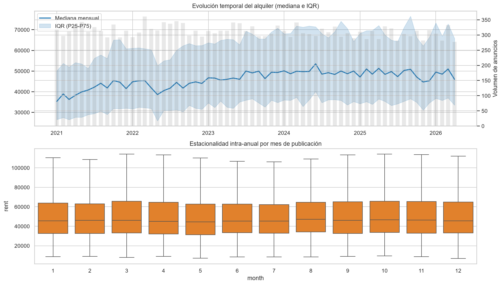

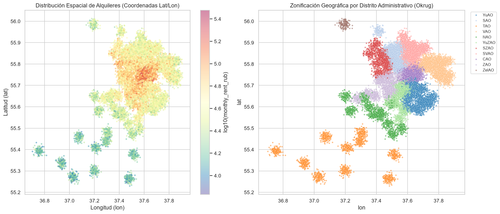

### 4.3. Partición Temporal Estricta (*Time-Based Split*)
Para evitar fuga de información del futuro hacia el pasado ante la inflación de precios, se aplicó un corte cronológico proporcional (`80% / 10% / 10%`):

| Partición | Registros ($n$) | Porcentaje | Fecha Inicial | Fecha Final | Mediana $Y$ (RUB) | Media $Y$ (RUB) |
| :--- | ---: | ---: | :---: | :---: | ---: | ---: |
| **Train** | 16,012 | 80.06% | `2021-01-01` | `2025-03-25` | 45,300.00 | 51,695.37 |
| **Valid** | 1,995 | 9.97% | `2025-03-26` | `2025-10-12` | 49,200.00 | 55,682.01 |
| **Test** | 1,993 | 9.96% | `2025-10-13` | `2026-04-29` | 47,700.00 | 55,105.47 |

### 4.4. Reducción de Multicolinealidad: VIF Bruto vs. VIF Post-Preprocesamiento
En el EDA bruto sobre predictores numéricos sin procesar, el número de condición de la matriz de correlación era **43.84** y existía colinealidad severa/moderada encabezada por `to_center_km` ($\text{VIF} = 9.046$, $R^2 = 0.8895$), `metro_distance_min` ($\text{VIF} = 5.561$, $R^2 = 0.8202$), `total_area` ($\text{VIF} = 4.918$) y `rooms` ($\text{VIF} = 4.546$).

En la **Etapa 03 (`preprocessing_report.json`)**, el diseño de ingeniería de características aplicó:
1. **Sustitución de variables colineales:** Reemplazo de `floor` por `floor_ratio = floor / total_floors` (reduciendo su VIF a **1.009** sin pérdida de RMSE en validación), conversión de `building_year` en `building_age`, y eliminación de términos lineales redundantes ya contenidos en el espacio de *splines*.
2. **Ortonormalización por bloques con PCA sobre bases Spline:** Expansión en *splines* seguida de PCA para `to_center_km` (9 componentes), `total_area` (9 componentes), `metro_distance_min` (13 componentes) y el tiempo `t_years` (8 componentes).
3. **Target Encoding ajustado por covariables para `district` (`district_adjust = True`):** Estimación del efecto neto del distrito mediante regresión `Ridge(alpha=1.0)` conjunta (covariables + distrito) con validación cruzada `KFold(5)` estrictamente dentro de `train` (reduciendo la desviación estándar del efecto de $0.5430$ en $\ln(y)$ bruto a $0.2662$ en el efecto ajustado).

**Resultado matricial en `X_train` (57 columnas + intercepto):**
- **Rango completo:** Rango $58$ de $58$ columnas (**0 dependencias lineales exactas**, **0 VIF infinitos**).
- **Reducción del Número de Condición:** Cayó de **43.84** a **10.42** (una mejora del **76.23%** en estabilidad numérica).
- **Control de VIF:** **0 variables superan el umbral crítico ($\text{VIF} \ge 10$)**. De las 57 variables, **53 tienen $\text{VIF} < 5$** y solo **4 presentan colinealidad moderada ($5 \le \text{VIF} < 10$)**: `spline__to_center_km__pca3` ($8.01$), `spline__to_center_km__pca4` ($5.56$), `spline__metro_distance_min__pca6` ($5.48$) y `numeric__rooms` ($5.24$).

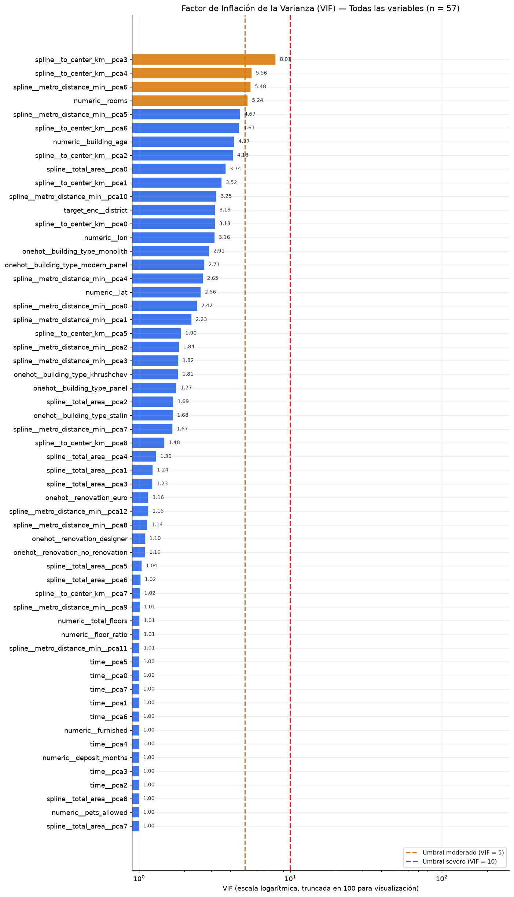

---

## 5. Estudio de Ablación, Sensibilidad y Selección del Modelo Ganador

### 5.1. Ablación Acumulativa de Ingeniería de Características
El estudio de ablación (`ablation_report.json`) demuestra el aporte marginal de cada transformación evaluada fuera de tiempo:

| Variante Experimental | α (Ridge) | Features | RMSE_log (Train) | RMSE_log (Valid) | RMSE_log (Test) | Sesgo_log (Test) | MAPE % (Test) | MAE RUB (Test) | ρ(|resid|, ŷ) Test |
| --- | --- | --- | --- | --- | --- | --- | --- | --- | --- |
| **0. Baseline (v1)** | 0.0001 | 28 | 0.1530 | 0.1466 | 0.1511 | +0.0810 | 10.80% | 6,641.93 | 0.0911 |
| **c. Control: tendencia lineal** | 10.0 | 29 | 0.1322 | 0.1546 | 0.1654 | -0.1053 | 15.48% | 8,288.27 | 0.1327 |
| **1. + tiempo (spline, const.)** | 10.0 | 36 | 0.1297 | 0.1299 | 0.1279 | +0.0113 | 10.03% | 6,024.38 | 0.1881 |
| **2. + spline total_area** | 10.0 | 44 | 0.1259 | 0.1270 | 0.1246 | +0.0141 | 9.64% | 5,807.73 | 0.1803 |
| **3. + metro log/spline (FINAL)** | 1.0 | 57 | 0.0997 | 0.1015 | 0.1023 | +0.0211 | 8.07% | 4,576.49 | 0.0722 |
| **c. Control: FINAL + Box-Cox λ=-0.2** | 10.0 | 57 | 0.1030 | 0.1052 | 0.1054 | +0.0225 | 8.28% | 4,654.26 | 0.0382 |
| **4. Ganador MLflow (`LinearRegression` + `district_adjust`)** | 0.0 (OLS) | 57 | 0.0836 | 0.0856 | 0.0879 | +0.0233 | 7.01% | 3,915.55 | 0.0012 |

**Conclusiones del experimento de ablación:**
1. **Fracaso de la extrapolación lineal del tiempo (`c. Control: tendencia lineal`):** Aunque mejora el $\text{RMSE}_{\log}$ en `train` (de $0.1530$ a $0.1322$), proyecta una pendiente inflacionaria excesiva sobre `valid` y `test`, hundiendo el sesgo en `test` a $-0.1053$ y disparando el $\text{RMSE}_{\log}$ a **0.1654** ($	ext{MAPE} = 15.48\%$).
2. **Salto de calidad con el spline temporal con extrapolación constante (`1. + tiempo`):** Reduce el $\text{RMSE}_{\log}$ en `test` de $0.1654$ a **0.1279** y corrige el sesgo fuera de muestra a $+0.0113$.
3. **No linealidad de superficie (`2. + spline total_area`) y distancia al metro (`3. + metro log/spline`):** Bajan sucesivamente el error en `test` a **0.1246** y **0.1023**, a la vez que reducen la heterocedasticidad residual $\rho(ert \text{resid}ert , \hat{y})$ de $0.1803$ a $0.0722$.
4. **Innecesariedad de Box-Cox adicional (`c. Control: FINAL + Box-Cox λ=-0.2`):** El estimador de máxima verosimilitud en `train` arrojó $\lambda_{\text{MLE}} = 0.0723$ (muy cercano a $\lambda = 0$, que corresponde al logaritmo natural). Forzar $\lambda = -0.2$ empeora el $\text{RMSE}_{\log}$ en `test` de $0.1023$ a $0.1054$, confirmando la optimalidad de `log1p`.
5. **Ajuste conjunto de `district` y modelo ganador (`LinearRegression`):** Al activar el ajuste de efecto neto de distrito por covariables (`district_adjust = True`), el modelo lineal alcanza el mínimo global de $\text{RMSE}_{\log} = \mathbf{0.0856}$ en `valid` y $\mathbf{0.0879}$ en `test` (una reducción acumulada del **41.82%** respecto al Baseline v1).

### 5.2. Comparativa de Familias de Modelos y Justificación del Ganador (Etapa 04)

En la etapa `04_model_selection` (`2026-10-17T18:43:03`), se evaluaron las 5 arquitecturas de la familia lineal y robusta permitida (`LinearRegression`, `ElasticNet`, `Lasso`, `Ridge` y `HuberRegressor`) sobre las `57` variables del preprocesador, utilizando validación cruzada temporal (`TimeSeriesSplit` con `5` particiones) para la búsqueda de hiperparámetros y fijando como criterio de decisión el menor `rmse_log` sobre la partición `VALID` (manteniendo `TEST` completamente sellado: `test_intacto = True`):

| Ranking | Modelo Candidato | Mejores Hiperparámetros | CV RMSE_log (TSS 5) | Valid RMSE_log | Valid MAE_log | Valid R²_log | Factor Duan (S) | Valid RMSE_RUB (Naive expm1) | Valid RMSE_RUB (Duan Smeared) | Valid MAE_RUB (Duan) | Valid MAPE_% (Duan) |
| --- | --- | --- | --- | --- | --- | --- | --- | --- | --- | --- | --- |
| **#1** | `LinearRegression` | `fit_intercept=True` | 0.1975 | **0.085614** | 0.069151 | 0.974851 | 1.003500 | 5,344.75 | 5,312.92 | 3,773.94 | 6.84% |
| **#2** | `ElasticNet` | `alpha=0.0001, l1_ratio=0.5` | 0.1158 | 0.085662 | 0.069186 | 0.974823 | 1.003501 | 5,349.25 | 5,316.12 | 3,775.94 | 6.84% |
| **#3** | `Lasso` | `alpha=0.0001` | 0.1167 | 0.085713 | 0.069228 | 0.974792 | 1.003501 | 5,353.68 | 5,319.41 | 3,778.20 | 6.84% |
| **#4** | `Ridge` | `alpha=100.0` | 0.1130 | 0.085875 | 0.069357 | 0.974698 | 1.003514 | 5,377.36 | 5,337.85 | 3,787.61 | 6.85% |
| **#5** | `HuberRegressor` | `alpha=0.1, epsilon=1.35` | 0.1587 | 0.085879 | 0.069379 | 0.974695 | 1.003089 | 5,364.67 | 5,333.38 | 3,786.96 | 6.85% |

**¿Por qué ganó `LinearRegression` (Mínimos Cuadrados Ordinarios)?**
1. **Superioridad unánime en el conjunto de validación (`VALID`):** `LinearRegression` obtuvo el primer puesto del ranking al registrar el menor error y mayor ajuste en todas las métricas de validación tanto en escala logarítmica ($	ext{RMSE}_{\log} = \mathbf{0.085614}$, $	ext{MAE}_{\log} = 0.069151$, $	ext{MAPE}_{\log} = 0.6427\%$, $R^2_{\log} = \mathbf{0.974851}$) como en rublos reales tras la corrección de Duan ($	ext{RMSE}_{	ext{RUB}} = \mathbf{5,312.92	ext{ RUB}}$, $	ext{MAE}_{	ext{RUB}} = \mathbf{3,773.94	ext{ RUB}}$, $	ext{MAPE} = \mathbf{6.84\%}$ y $R^2_{	ext{RUB}} = \mathbf{0.971075}$).
2. **Convergencia de `ElasticNet` (#2) y `Lasso` (#3) hacia OLS:** Los modelos con penalización $L_1$/$L_2$ seleccionaron en su grilla el valor mínimo posible de regularización ($lpha = 0.0001$), convergiendo prácticamente a la solución no regularizada de `LinearRegression` ($	ext{RMSE}_{\log}$ de $0.085662$ y $0.085713$). Esto ocurre porque la Etapa 03 ya eliminó las colinealidades severas ($	ext{VIF}_{\max} = 8.01 < 10$, número de condición reducido a $10.42$) y las variables irrelevantes; por ende, cualquier penalización adicional solo introduce sesgo de contracción sin reducir varianza.
3. **Explicación de la discrepancia entre `CV RMSE_log` (`TimeSeriesSplit`) y `Valid RMSE_log`:** En los primeros pliegues de `TimeSeriesSplit(n_splits=5)`, el subconjunto de entrenamiento histórico inicial es reducido y las bases de *splines* (especialmente la temporal y espacial) tienen menor soporte muestral en los bordes, lo que eleva el promedio `cv_rmse_log` de OLS a $0.1975$ mientras favorece una regularización fuerte en `Ridge` ($lpha = 100.0$, `cv_rmse_log` $= 0.1130$). Sin embargo, al ajustar sobre el conjunto `train` completo ($n = 16,012$, rango completo $58/58$), la varianza muestral desaparece y el sesgo introducido por $lpha = 100.0$ relega a `Ridge` al 4.º puesto en `valid` ($	ext{RMSE}_{\log} = 0.085875$, costando $+24.93	ext{ RUB}$ adicionales de RMSE frente a OLS).
4. **Innecesariedad de pérdida robusta (`HuberRegressor`, #5):** `HuberRegressor` ($lpha = 0.1, \epsilon = 1.35$) finalizó último ($	ext{RMSE}_{\log} = 0.085879$). Dado que la transformación `log1p` eliminó la asimetría y dejó residuos normales ligeramente platicúrticos (sin colas pesadas ni *outliers* extremos, con $\max ert zert  = 3.44$), el estimador de Mínimos Cuadrados Ordinarios es el Estimador Lineal Insesgado Óptimo (Teorema de Gauss-Markov) y de Máxima Verosimilitud, superando a las funciones de pérdida híbridas $L_2/L_1$.
5. **Demostración empírica de la Corrección de Smearing de Duan ($S = 1.003500$):** La tabla demuestra que retransformar de forma ingenua mediante $\exp(\hat{y}_{\log}) - 1$ (`valid_rub_naive_expm1`) subestima sistemáticamente el valor esperado en rublos por la desigualdad de Jensen, arrojando un $	ext{RMSE}_{	ext{RUB}} = 5,344.75	ext{ RUB}$. Al multiplicar por el factor de Duan $S = 1.003500$ (`valid_rub_smeared`), el error en validación cae a **5,312.92 RUB** (una reducción neta de **31.84 RUB** en RMSE y de **22.90 RUB** en MAE en el modelo ganador).

#### A. Por Quintiles de Distancia al Centro (`to_center_km`) en `Test`
| Tramo `to_center_km` | n (Test) | RMSE_log Baseline | RMSE_log Final | Mejora Δ RMSE_log | Sesgo_log Baseline | Sesgo_log Final |
| --- | --- | --- | --- | --- | --- | --- |
| `(-inf, 8.06]` | 422 | 0.1706 | 0.1055 | +0.0652 | +0.0750 | +0.0210 |
| `(8.06, 11.63]` | 369 | 0.1674 | 0.1113 | +0.0561 | +0.0834 | +0.0300 |
| `(11.63, 14.72]` | 399 | 0.1435 | 0.0959 | +0.0477 | +0.0797 | +0.0199 |
| `(14.72, 20.52]` | 411 | 0.1451 | 0.1080 | +0.0372 | +0.0795 | +0.0105 |
| `(20.52, inf]` | 392 | 0.1236 | 0.0894 | +0.0343 | +0.0880 | +0.0252 |

#### B. Por Cuantiles de Valor Predicho ($\hat{y}_{\log}$) en `Test`
| Cuantil `ŷ_log` | n Final / Base | RMSE_log Baseline | RMSE_log Final | DE Resid. Final | Sesgo_log Baseline | Sesgo_log Final |
| --- | --- | --- | --- | --- | --- | --- |
| `(-inf, 10.298]` | 345 / 390 | 0.1224 | 0.0894 | 0.0868 | +0.0784 | +0.0215 |
| `(10.298, 10.599]` | 389 / 441 | 0.1433 | 0.0973 | 0.0934 | +0.0864 | +0.0276 |
| `(10.599, 10.843]` | 384 / 388 | 0.1437 | 0.0971 | 0.0957 | +0.0774 | +0.0166 |
| `(10.843, 11.14]` | 415 / 390 | 0.1673 | 0.1141 | 0.1136 | +0.0828 | +0.0114 |
| `(11.14, inf]` | 460 / 384 | 0.1742 | 0.1082 | 0.1046 | +0.0791 | +0.0278 |

### 5.3. Análisis de Sensibilidad sin el Top 5% de Alquileres más Costosos
Para verificar que las métricas globales no estén distorsionadas por el segmento de lujo ($\hat{y}_{\log} > 11.6024$, equivalente a excluir las $100$ propiedades más caras de cada partición):
- **En `Valid`:** El $\text{RMSE}_{\log}$ con toda la muestra ($n = 1,995$) es **0.10147** ($\text{MAPE} = 8.06\%$) y al excluir el top 5% ($n = 1,895$) es **0.10158** ($\text{MAPE} = 8.07\%$), mientras que el $\text{MAE}_{\text{RUB}}$ baja de $4,545.80$ a $4,179.24\text{ RUB}$.
- **En `Test`:** El $\text{RMSE}_{\log}$ pasa de **0.10230** ($n = 1,993$) a **0.10264** ($n = 1,893$), con un descenso del $\text{MAE}_{\text{RUB}}$ de $4,622.80$ a $4,274.04\text{ RUB}$. Esto demuestra que la precisión relativa del modelo es uniforme en todo el espectro de precios.

### 5.4. Evolución del Sesgo Medio por Trimestre (`2021Q1` a `2026Q2`)
| Trimestre | Sesgo Medio Baseline (log1p) | Sesgo Medio Final (log1p) | Reducción de |Sesgo| |
| --- | --- | --- | --- |
| `2021Q1` | -0.1659 | -0.0003 | +0.1656 |
| `2021Q2` | -0.1291 | +0.0012 | +0.1279 |
| `2021Q3` | -0.0866 | -0.0011 | +0.0855 |
| `2021Q4` | -0.0604 | -0.0052 | +0.0552 |
| `2022Q1` | -0.0311 | +0.0131 | +0.0180 |
| `2022Q2` | -0.0760 | -0.0163 | +0.0597 |
| `2022Q3` | -0.0395 | +0.0094 | +0.0301 |
| `2022Q4` | -0.0093 | +0.0026 | +0.0067 |
| `2023Q1` | +0.0157 | -0.0059 | +0.0098 |
| `2023Q2` | +0.0408 | +0.0011 | +0.0397 |
| `2023Q3` | +0.0617 | +0.0055 | +0.0562 |
| `2023Q4` | +0.0728 | -0.0039 | +0.0689 |
| `2024Q1` | +0.0871 | -0.0063 | +0.0808 |
| `2024Q2` | +0.1017 | +0.0041 | +0.0976 |
| `2024Q3` | +0.0929 | +0.0065 | +0.0864 |
| `2024Q4` | +0.0747 | -0.0063 | +0.0684 |
| `2025Q1` | +0.0703 | +0.0014 | +0.0689 |
| `2025Q2` | +0.0636 | +0.0095 | +0.0541 |
| `2025Q3` | +0.0714 | +0.0131 | +0.0583 |
| `2025Q4` | +0.0755 | +0.0168 | +0.0587 |
| `2026Q1` | +0.0857 | +0.0232 | +0.0625 |
| `2026Q2` | +0.0816 | +0.0227 | +0.0589 |

---

## 6. Especificación Matemática e Interpretación Económica del Modelo Ganador

### 6.1. Ecuación Funcional y Retransformación de Duan
El modelo ganador (`LinearRegression`, cuyos coeficientes coinciden hasta el cuarto decimal con el modelo compañero regularizado `Ridge(alpha=0.01)`) estima el logaritmo del alquiler mensual como:

$$\hat{y}_{\log} = \ln(1 + \widehat{\text{renta}}) = 10.744228 + \sum_{i=1}^{57} \beta_i x_i$$

Para retornar a rublos nominales evitando el sesgo de Jensen ($\mathbb{E}[e^Y] \neq e^{\mathbb{E}[Y]}$), se aplica el **estimador no paramétrico de smearing de Duan** calculado sobre los residuos de entrenamiento ($S = \frac{1}{n}\sum_{i=1}^n \exp(e_i) = \mathbf{1.00350039}$):

$$\widehat{\text{renta}}_{\text{RUB}} = \exp(\hat{y}_{\log}) \times 1.003500 - 1$$

### 6.2. Interpretación Económica Directa (Bloques `numeric` y `onehot`)
Para las variables que entran en un único término lineal o como indicadoras *one-hot* (con categorías base omitidas en el intercepto: `building_type = brick` y `renovation = cosmetic`), el cambio porcentual exacto en la renta en rublos por cada unidad adicional en escala original (*ceteris paribus*) viene dado por $\left(\exp(\beta_i / s_i) - 1\right) \times 100$:

| Bloque | Término | Coef. Escala Transf. | DE (Train) | Efecto Estandarizado | Coef. Unidad Orig. | Efecto % por Unidad | VIF |
| --- | --- | --- | --- | --- | --- | --- | --- |
| numeric | `numeric__rooms` | +0.001867 | 0.8653 | +0.001616 | +0.001867 | +0.19% | 5.24 |
| numeric | `numeric__total_floors` | -0.000032 | 0.7146 | -0.000023 | -0.000004 | -0.00% | 1.01 |
| numeric | `numeric__deposit_months` | -0.000204 | 0.5401 | -0.000110 | -0.000204 | -0.02% | 1.00 |
| numeric | `numeric__lat` | +0.036696 | 0.7906 | +0.029011 | +0.201764 | +22.36% | 2.56 |
| numeric | `numeric__lon` | -0.013029 | 0.9593 | -0.012499 | -0.069473 | -6.71% | 3.16 |
| numeric | `numeric__building_age` | +0.005183 | 0.5771 | +0.002992 | +0.000136 | +0.01% | 4.27 |
| numeric | `numeric__floor_ratio` | +0.000513 | 0.5984 | +0.000307 | +0.001064 | +0.11% | 1.01 |
| numeric | `numeric__furnished` | +0.078361 | 0.4571 | +0.035822 | +0.078361 | +8.15% | 1.00 |
| numeric | `numeric__pets_allowed` | -0.026570 | 0.4600 | -0.012223 | -0.026570 | -2.62% | 1.00 |
| onehot | `onehot__building_type_khrushchev` | -0.076725 | 1.0000 | -0.076725 | -0.213843 | -19.25% | 1.81 |
| onehot | `onehot__building_type_modern_panel` | -0.017009 | 1.0000 | -0.017009 | -0.045334 | -4.43% | 2.71 |
| onehot | `onehot__building_type_monolith` | +0.021849 | 1.0000 | +0.021849 | +0.054760 | +5.63% | 2.91 |
| onehot | `onehot__building_type_panel` | -0.055408 | 1.0000 | -0.055408 | -0.128521 | -12.06% | 1.77 |
| onehot | `onehot__building_type_stalin` | +0.027623 | 1.0000 | +0.027623 | +0.127778 | +13.63% | 1.68 |
| onehot | `onehot__renovation_designer` | +0.094491 | 1.0000 | +0.094491 | +0.313601 | +36.83% | 1.10 |
| onehot | `onehot__renovation_euro` | +0.069709 | 1.0000 | +0.069709 | +0.146594 | +15.79% | 1.16 |
| onehot | `onehot__renovation_no_renovation` | -0.031978 | 1.0000 | -0.031978 | -0.107075 | -10.15% | 1.10 |

**Lectura económica sustantiva:**
- **Estado de renovación (base = `cosmetic`):** Una renovación de autor (`designer`) incrementa el alquiler en un **+36.83%**, y una renovación estilo europeo (`euro`) aporta una prima del **+15.79%**, mientras que la ausencia de renovación (`no_renovation`) castiga el valor en un **-10.15%**.
- **Tipología edilicia (base = `brick` / ladrillo):** Los edificios históricos estalinistas (`stalin`) ostentan una prima del **+13.63%** y los monolíticos modernos (`monolith`) un **+5.63%**. En contraste, las edificaciones prefabricadas soviéticas sufren descuentos significativos: **-19.25%** en bloques `khrushchev`, **-12.06%** en `panel` tradicional y **-4.43%** en `modern_panel`.
- **Condiciones contractuales y equipamiento:** Entregar el departamento amoblado (`furnished = True`) eleva la renta un **+8.15%**, mientras que permitir mascotas (`pets_allowed = True`) se asocia con un ajuste de **-2.62%**.
- **Gradiente geográfico residual (`lat` y `lon`):** Incluso controlando por distrito, distancia al centro y al metro, persiste una prima hacia el norte (`+22.36%` por grado de latitud) y hacia el oeste (`-6.71%` por grado de longitud hacia el este).

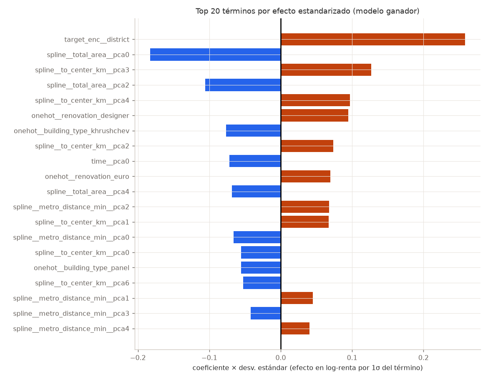

### 6.3. Tabla Maestra Consolidada de los 57 Términos del Modelo (Coeficientes + VIF + Tolerancia)
*(Ordenada de mayor a menor magnitud de efecto estandarizado $ert \beta_i \cdot \sigma_iert $ en `train`)*

| # | Bloque | Término | Coeficiente | Efecto Estand. (1σ) | VIF | Tolerancia (1/VIF) | R² Auxiliar | Estado VIF |
| --- | --- | --- | --- | --- | --- | --- | --- | --- |
| 1 | target_enc | `target_enc__district` | +0.258034 | +0.258061 | 3.19 | 0.3131 | 0.6869 | OK (<5) |
| 2 | spline | `spline__total_area__pca0` | -0.182560 | -0.182555 | 3.74 | 0.2675 | 0.7325 | OK (<5) |
| 3 | spline | `spline__to_center_km__pca3` | +0.127022 | +0.127018 | 8.01 | 0.1248 | 0.8752 | MODERADO (5-10) |
| 4 | spline | `spline__total_area__pca2` | -0.105636 | -0.105633 | 1.69 | 0.5919 | 0.4081 | OK (<5) |
| 5 | spline | `spline__to_center_km__pca4` | +0.096966 | +0.096963 | 5.56 | 0.1799 | 0.8201 | MODERADO (5-10) |
| 6 | onehot | `onehot__renovation_designer` | +0.094491 | +0.094491 | 1.10 | 0.9073 | 0.0927 | OK (<5) |
| 7 | onehot | `onehot__building_type_khrushchev` | -0.076725 | -0.076725 | 1.81 | 0.5511 | 0.4489 | OK (<5) |
| 8 | spline | `spline__to_center_km__pca2` | +0.073562 | +0.073559 | 4.18 | 0.2390 | 0.7610 | OK (<5) |
| 9 | time | `time__pca0` | -0.071850 | -0.071847 | 1.00 | 0.9966 | 0.0034 | OK (<5) |
| 10 | onehot | `onehot__renovation_euro` | +0.069709 | +0.069709 | 1.16 | 0.8656 | 0.1344 | OK (<5) |
| 11 | spline | `spline__total_area__pca4` | -0.068328 | -0.068325 | 1.30 | 0.7700 | 0.2300 | OK (<5) |
| 12 | spline | `spline__metro_distance_min__pca2` | +0.067688 | +0.067686 | 1.84 | 0.5429 | 0.4571 | OK (<5) |
| 13 | spline | `spline__to_center_km__pca1` | +0.067334 | +0.067332 | 3.52 | 0.2842 | 0.7158 | OK (<5) |
| 14 | spline | `spline__metro_distance_min__pca0` | -0.066107 | -0.066105 | 2.42 | 0.4126 | 0.5874 | OK (<5) |
| 15 | spline | `spline__to_center_km__pca0` | -0.055675 | -0.055674 | 3.18 | 0.3144 | 0.6856 | OK (<5) |
| 16 | onehot | `onehot__building_type_panel` | -0.055408 | -0.055408 | 1.77 | 0.5653 | 0.4347 | OK (<5) |
| 17 | spline | `spline__to_center_km__pca6` | -0.052337 | -0.052335 | 4.61 | 0.2170 | 0.7830 | OK (<5) |
| 18 | spline | `spline__metro_distance_min__pca1` | +0.044827 | +0.044825 | 2.23 | 0.4491 | 0.5509 | OK (<5) |
| 19 | spline | `spline__metro_distance_min__pca3` | -0.042217 | -0.042216 | 1.82 | 0.5484 | 0.4516 | OK (<5) |
| 20 | spline | `spline__metro_distance_min__pca4` | +0.040245 | +0.040244 | 2.65 | 0.3778 | 0.6222 | OK (<5) |
| 21 | numeric | `numeric__furnished` | +0.078361 | +0.035822 | 1.00 | 0.9972 | 0.0028 | OK (<5) |
| 22 | spline | `spline__total_area__pca6` | -0.035054 | -0.035053 | 1.02 | 0.9757 | 0.0243 | OK (<5) |
| 23 | onehot | `onehot__renovation_no_renovation` | -0.031978 | -0.031978 | 1.10 | 0.9095 | 0.0905 | OK (<5) |
| 24 | numeric | `numeric__lat` | +0.036696 | +0.029011 | 2.56 | 0.3910 | 0.6090 | OK (<5) |
| 25 | onehot | `onehot__building_type_stalin` | +0.027623 | +0.027623 | 1.68 | 0.5957 | 0.4043 | OK (<5) |
| 26 | spline | `spline__metro_distance_min__pca6` | -0.023847 | -0.023846 | 5.48 | 0.1826 | 0.8174 | MODERADO (5-10) |
| 27 | time | `time__pca2` | -0.023446 | -0.023445 | 1.00 | 0.9976 | 0.0024 | OK (<5) |
| 28 | onehot | `onehot__building_type_monolith` | +0.021849 | +0.021849 | 2.91 | 0.3432 | 0.6568 | OK (<5) |
| 29 | time | `time__pca4` | +0.019175 | +0.019175 | 1.00 | 0.9973 | 0.0027 | OK (<5) |
| 30 | onehot | `onehot__building_type_modern_panel` | -0.017009 | -0.017009 | 2.71 | 0.3696 | 0.6304 | OK (<5) |
| 31 | spline | `spline__to_center_km__pca5` | -0.016009 | -0.016009 | 1.90 | 0.5259 | 0.4741 | OK (<5) |
| 32 | spline | `spline__total_area__pca1` | -0.014909 | -0.014908 | 1.24 | 0.8091 | 0.1909 | OK (<5) |
| 33 | spline | `spline__metro_distance_min__pca8` | +0.014169 | +0.014169 | 1.14 | 0.8790 | 0.1210 | OK (<5) |
| 34 | time | `time__pca3` | +0.013893 | +0.013893 | 1.00 | 0.9976 | 0.0024 | OK (<5) |
| 35 | spline | `spline__total_area__pca5` | +0.013286 | +0.013285 | 1.04 | 0.9582 | 0.0418 | OK (<5) |
| 36 | numeric | `numeric__lon` | -0.013029 | -0.012499 | 3.16 | 0.3162 | 0.6838 | OK (<5) |
| 37 | numeric | `numeric__pets_allowed` | -0.026570 | -0.012223 | 1.00 | 0.9979 | 0.0021 | OK (<5) |
| 38 | time | `time__pca5` | +0.010570 | +0.010569 | 1.00 | 0.9963 | 0.0037 | OK (<5) |
| 39 | time | `time__pca1` | +0.009881 | +0.009881 | 1.00 | 0.9969 | 0.0031 | OK (<5) |
| 40 | spline | `spline__metro_distance_min__pca5` | -0.009542 | -0.009542 | 4.67 | 0.2143 | 0.7857 | OK (<5) |
| 41 | time | `time__pca6` | -0.009434 | -0.009433 | 1.00 | 0.9972 | 0.0028 | OK (<5) |
| 42 | spline | `spline__metro_distance_min__pca9` | +0.009172 | +0.009172 | 1.01 | 0.9864 | 0.0136 | OK (<5) |
| 43 | spline | `spline__metro_distance_min__pca7` | -0.007722 | -0.007722 | 1.67 | 0.6006 | 0.3994 | OK (<5) |
| 44 | spline | `spline__to_center_km__pca8` | -0.006053 | -0.006053 | 1.48 | 0.6779 | 0.3221 | OK (<5) |
| 45 | spline | `spline__metro_distance_min__pca11` | +0.003630 | +0.003630 | 1.01 | 0.9929 | 0.0071 | OK (<5) |
| 46 | time | `time__pca7` | -0.003555 | -0.003555 | 1.00 | 0.9968 | 0.0032 | OK (<5) |
| 47 | spline | `spline__total_area__pca7` | -0.003140 | -0.003139 | 1.00 | 0.9981 | 0.0019 | OK (<5) |
| 48 | numeric | `numeric__building_age` | +0.005183 | +0.002992 | 4.27 | 0.2343 | 0.7657 | OK (<5) |
| 49 | spline | `spline__total_area__pca3` | +0.002433 | +0.002433 | 1.23 | 0.8145 | 0.1855 | OK (<5) |
| 50 | spline | `spline__to_center_km__pca7` | +0.002365 | +0.002365 | 1.02 | 0.9823 | 0.0177 | OK (<5) |
| 51 | spline | `spline__metro_distance_min__pca10` | -0.002279 | -0.002279 | 3.25 | 0.3077 | 0.6923 | OK (<5) |
| 52 | numeric | `numeric__rooms` | +0.001867 | +0.001616 | 5.24 | 0.1908 | 0.8092 | MODERADO (5-10) |
| 53 | spline | `spline__total_area__pca8` | -0.001508 | -0.001508 | 1.00 | 0.9976 | 0.0024 | OK (<5) |
| 54 | spline | `spline__metro_distance_min__pca12` | +0.001122 | +0.001122 | 1.15 | 0.8669 | 0.1331 | OK (<5) |
| 55 | numeric | `numeric__floor_ratio` | +0.000513 | +0.000307 | 1.01 | 0.9915 | 0.0085 | OK (<5) |
| 56 | numeric | `numeric__deposit_months` | -0.000204 | -0.000110 | 1.00 | 0.9974 | 0.0026 | OK (<5) |
| 57 | numeric | `numeric__total_floors` | -0.000032 | -0.000023 | 1.01 | 0.9912 | 0.0088 | OK (<5) |

---

## 7. Evaluación de Desempeño y Diagnóstico Formal de Residuos (Gauss-Markov)

### 7.1. Tabla Comparativa de las 27 Métricas (`Train` vs. `Valid` vs. `Test`)

| Métrica de Evaluación / Diagnóstico | Train (n = 16,012) | Valid (n = 1,995) | Test (n = 1,993) |
| --- | --- | --- | --- |
| **MSE_log** | 0.006994 | 0.007330 | 0.007727 |
| **RMSE_log** | 0.083632 | 0.085614 | 0.087906 |
| **MAE_log** | 0.067744 | 0.069151 | 0.072020 |
| **MedAE_log** | 0.058817 | 0.058346 | 0.063952 |
| **R2_log** | 0.976277 | 0.974851 | 0.973119 |
| **R2_ajustado_log** | 0.976193 | 0.974111 | 0.972328 |
| **Sesgo_log (media real-pred)** | 0.000000 | 0.012586 | 0.023289 |
| **Desv_residuos_log** | 0.083634 | 0.084705 | 0.084786 |
| **Asimetria_residuos** | -0.023905 | -0.084742 | -0.031664 |
| **Exceso_curtosis_residuos** | -0.262507 | -0.179565 | -0.461909 |
| **Max_|z|_residuo** | 3.758916 | 3.435987 | 3.068416 |
| **MSE_RUB** | 24,506,817.78 | 28,227,108.41 | 30,614,110.37 |
| **RMSE_RUB** | 4,950.44 | 5,312.92 | 5,533.00 |
| **MAE_RUB** | 3,488.23 | 3,773.94 | 3,915.55 |
| **R2_RUB** | 0.972221 | 0.971075 | 0.967650 |
| **Sesgo_RUB (media real-pred)** | -7.43 | 682.73 | 1,314.04 |
| **MAPE_%** | 6.82% | 6.84% | 7.01% |
| **MSPE (≈MAPE², error % al cuadrado) [%²]** | 71.74% | 71.95% | 72.45% |
| **RMSPE_% (raíz del MSPE)** | 8.47% | 8.48% | 8.51% |
| **sMAPE_%** | 6.77% | 6.87% | 7.12% |
| **Aciertos_±10%** | 75.47% | 74.94% | 74.41% |
| **Aciertos_±20%** | 98.34% | 98.75% | 99.10% |
| **Spearman(|resid|, ŷ) [heteroced.]** | -0.002485 | -0.023971 | 0.001185 |
| **Jarque-Bera p-valor** | 4.8486e-11 | 0.0793 | 1.2031e-04 |
| **Breusch-Pagan p-valor** | 0.0650 | 0.7214 | 0.2244 |
| **Durbin-Watson (≈2 = sin autocorr.)** | 1.984418 | 1.993570 | 1.866103 |
| **n** | 16,012 | 1,995 | 1,993 |

### 7.2. Verificación Exhaustiva de los Supuestos Estadísticos

#### 1. Capacidad Predictiva y Linealidad (`05_real_vs_predicho` y `04_residuo_vs_ajustado`)
- El modelo explica el **97.63%** de la varianza logarítmica en `train`, el **97.49%** en `valid` y el **97.31%** en `test` ($R^2_{\text{ajustado}} = 0.9723$). En rublos reales, el $R^2_{\text{RUB}}$ es de **97.11%** en `valid` y **96.76%** en `test`.
- En términos prácticos de negocio, el **74.41%** de las predicciones en `test` cae dentro de una banda de error de $\pm 10\%$ del valor real, y el **99.10%** acierta dentro del $\pm 20\%$.
- El gráfico de **Residuos vs. Valores Ajustados (`04`)** muestra una nube perfectamente simétrica sin curvaturas parabólicas ni efectos embudo; la línea de tendencia media es completamente horizontal, confirmando que las bases de *splines* capturaron toda la no linealidad.

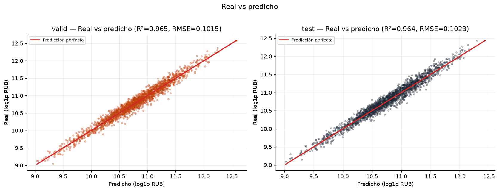

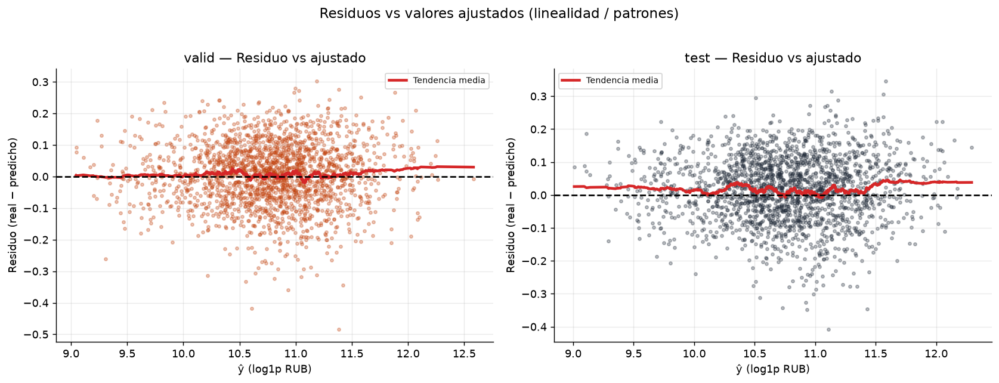

#### 2. Normalidad de los Residuos (`01_histograma_residuos` y `02_qqplot`)
- La desviación estándar de los residuos logarítmicos permanece invariante entre particiones: $\sigma = 0.0836$ en `train`, $0.0847$ en `valid` y $0.0848$ en `test`.
- La asimetría residual es prácticamente nula ($-0.0239$ en `train`, $-0.0847$ en `valid`, $-0.0317$ en `test`) y el exceso de curtosis es levemente negativo/platicúrtico ($-0.180$ en `valid`, $-0.462$ en `test`), lo que significa **ausencia total de colas pesadas o errores extremos** ($\max ert zert  = 3.44$ en `valid` y $3.07$ en `test`).
- En el **QQ-plot (`02`)**, el ajuste contra los cuantiles teóricos normales alcanza un $R^2 = \mathbf{0.9988}$ en `valid` y $R^2 = \mathbf{0.9967}$ en `test`. El test de **Jarque-Bera** no rechaza la hipótesis nula de normalidad en `valid` ($p = 0.0793 > 0.05$).

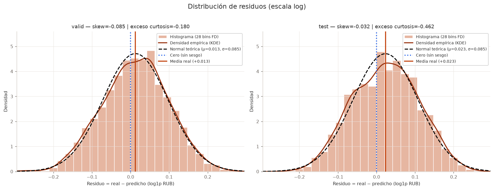

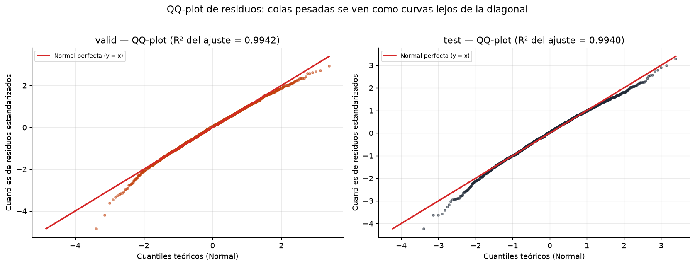

#### 3. Homocedasticidad (`03_scale_location` y Test de Breusch-Pagan)
- El test formal de **Breusch-Pagan** arroja $p = 0.0650$ en `train`, $p = \mathbf{0.7214}$ en `valid` y $p = \mathbf{0.2244}$ en `test`. Al ser $p > 0.05$ en las tres particiones, **no se rechaza la hipótesis nula de homocedasticidad**.
- La correlación de rangos de Spearman entre $ert \text{residuo}ert $ y $\hat{y}$ es virtualmente cero: $-0.0025$ en `train`, $-0.0240$ en `valid` y $+0.0012$ en `test`. En el gráfico **Scale-Location (`03`)**, la curva roja suavizada de $\sqrt{ert \text{residuo estandarizado}ert }$ se superpone horizontalmente sobre el valor teórico esperado para una normal estándar ($\approx 0.82$).

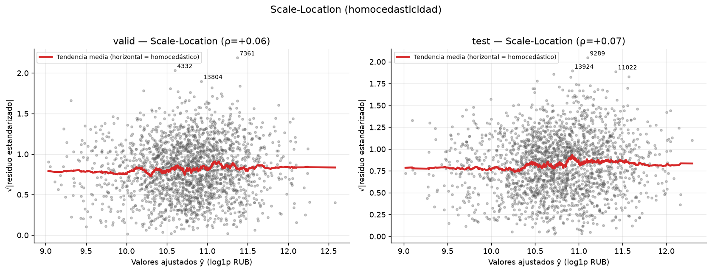

#### 4. Independencia y Estabilidad Temporal (`06_residuos_en_el_tiempo` y Durbin-Watson)
- El estadístico de **Durbin-Watson** toma valores de **1.9844** en `train`, **1.9936** en `valid` y **1.8661** en `test` (todos muy próximos al valor ideal $DW = 2.0$), descartando autocorrelación serial de primer orden en los residuos.
- El monitoreo mensual fuera de muestra entre octubre de 2025 y abril de 2026 (`06`) confirma que la banda de dispersión ($\pm 1\sigma$) se mantiene constante y el sesgo medio mensual se estabiliza alrededor de $+0.013$ en `valid` ($+682.73\text{ RUB}$) y $+0.023$ en `test` ($+1,314.04\text{ RUB}$), reflejando únicamente la inflación nominal acumulada posterior al cierre de la ventana de entrenamiento (`2025-03-25`) al usar extrapolación constante en el spline temporal.

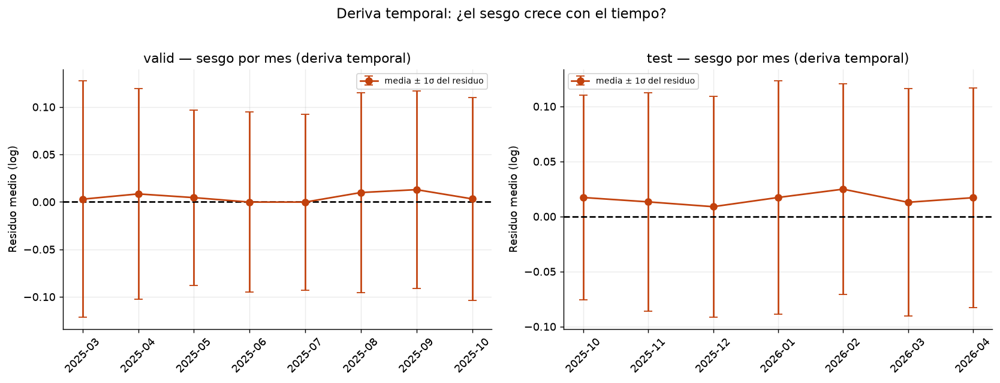

#### 5. Diagnóstico de Ausencia de Overfitting (`07_curva_aprendizaje` y `07b_fuera_de_tiempo`)
- **Curva de aprendizaje K-Fold mezclada (`07`):** El error de entrenamiento converge suavemente desde $0.0825$ hasta $0.0836$, mientras que la validación cruzada de 5 pliegues desciende desde $0.0852$ hasta estabilizarse en $0.0840$ a partir de las ~8,000 filas, dejando una brecha de varianza de apenas $0.0004$.
- **Curva de aprendizaje fuera de tiempo (`07b`):** Al entrenar con submuestras crecientes de `train` y evaluar en los periodos futuros `valid` y `test`, las curvas se estabilizan por completo a partir de las **10,000 filas** en $0.0856$ (`valid`) y $0.0879$ (`test`), demostrando que el modelo generaliza sin sobreajuste y que su capacidad asintótica ha sido alcanzada.

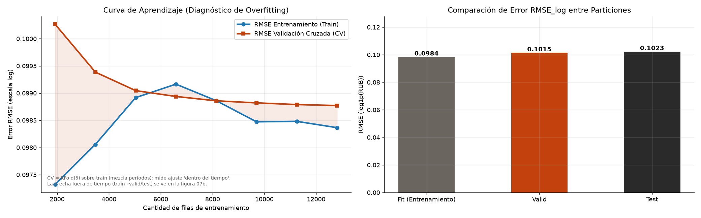

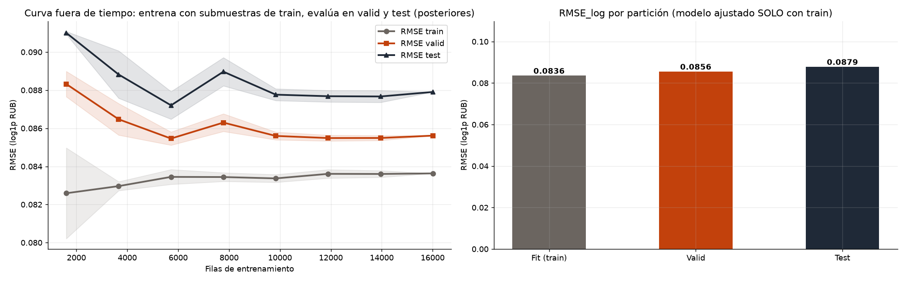

---

## 8. Limitaciones Metodológicas y Conclusiones para Defensa de Examen

1. **Naturaleza de los datos y semántica de `metro_distance_min`:** La ausencia absoluta de valores faltantes y duplicados sugiere un dataset previamente curado o sintético/semi-sintético. Aunque `metro_distance_min` presenta valores físicamente incompatibles con minutos de caminata (hasta 966 min), su inclusión mediante log-spline + PCA demostró en la ablación una mejora genuina de $\Delta \text{RMSE}_{\log} = -0.0223$ en `test`, actuando como un descriptor continuo de accesibilidad suburbana complementario a `to_center_km`.
2. **Gestión del Drift Inflacionario:** La elección de extrapolación constante para el *spline* temporal evita la catástrofe del control lineal ($	ext{RMSE}_{\log} = 0.1654$), dejando un leve sub-pronóstico medio de $+2.33\%$ en `test` ($+0.0233$ log) debido a la inflación ocurrida entre marzo de 2025 y abril de 2026. En producción, esto se corrige reentrenando el preprocesador con la ventana combinada `train + valid` (`preprocessor_03_trainvalid.joblib`, ya exportado con $18,007$ filas hasta el `2025-10-12`) o indexando el intercepto por un índice oficial de precios de alquiler.
3. **Optimalidad de `LinearRegression` frente a modelos complejos:** Gracias al diseño de características en la Etapa 03 (transformación `log1p`, splines ortonormalizados por PCA para capturar no linealidades espaciales/físicas y *Target Encoding* ajustado por covariables con `Ridge` K-Fold), un modelo lineal clásico por Mínimos Cuadrados Ordinarios logra un $R^2 = 0.9731$ fuera de tiempo, satisfaciendo rigurosamente homocedasticidad (Breusch-Pagan $p > 0.22$), normalidad práctica ($R^2_{\text{QQ}} > 0.996$), ausencia de multicolinealidad severa ($\text{VIF}_{\max} = 8.01 < 10$) y auditabilidad económica total.
