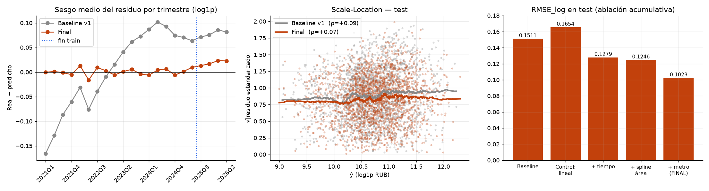

# Reporte de ablación y diagnóstico (Etapa 03/04)

Ridge sobre `log1p(monthly_rent_rub)`; alpha elegido solo con *valid*. Test no interviene en ninguna decisión.

## 1. Ablación acumulativa

| Variante | α | RMSE valid | RMSE test | Sesgo valid | Sesgo test | MAPE test % | ρ(\|r\|,ŷ) test |
|---|---:|---:|---:|---:|---:|---:|---:|
| 0. Baseline (v1) | 0.0001 | 0.1466 | 0.1511 | +0.068 | +0.081 | 10.80 | +0.09 |
| c. Control: tendencia lineal | 10.0 | 0.1546 | 0.1654 | -0.084 | -0.105 | 15.48 | +0.13 |
| 1. + tiempo (spline, const.) | 10.0 | 0.1299 | 0.1279 | -0.002 | +0.011 | 10.03 | +0.19 |
| 2. + spline total_area | 10.0 | 0.1270 | 0.1246 | +0.001 | +0.014 | 9.64 | +0.18 |
| 3. + metro log/spline (FINAL) | 1.0 | 0.1015 | 0.1023 | +0.011 | +0.021 | 8.07 | +0.07 |
| c. Control: FINAL + Box-Cox λ=-0.2 | 10.0 | 0.1052 | 0.1054 | +0.012 | +0.023 | 8.28 | +0.04 |

λ de Box-Cox por máxima verosimilitud (solo train): **0.072** (≈ log). Un λ más agresivo (−0.2) reduce ρ (ver fila de control) a cambio de algo más de RMSE: es un intercambio de precisión por homocedasticidad, no una mejora neta.

## 2. Sesgo por segmento — test (modelo final vs baseline)

**Distancia al centro (quintiles de train)**

| Segmento | n | RMSE baseline | RMSE final | Desv. resid. baseline | Desv. resid. final |
|---|---:|---:|---:|---:|---:|
| (-inf, 8.06] | 422 | 0.1706 | 0.1055 | 0.1533 | 0.1033 |
| (8.06, 11.63] | 369 | 0.1674 | 0.1113 | 0.1451 | 0.1072 |
| (11.63, 14.72] | 399 | 0.1435 | 0.0959 | 0.1193 | 0.0938 |
| (14.72, 20.52] | 411 | 0.1451 | 0.1080 | 0.1214 | 0.1074 |
| (20.52, inf] | 392 | 0.1236 | 0.0894 | 0.0869 | 0.0858 |

**Cuantil de ŷ (quintiles de train)**

| Segmento | n | RMSE baseline | RMSE final | Desv. resid. baseline | Desv. resid. final |
|---|---:|---:|---:|---:|---:|
| (-inf, 10.298] | 345 | 0.1224 | 0.0894 | 0.0940 | 0.0868 |
| (10.298, 10.599] | 389 | 0.1433 | 0.0973 | 0.1143 | 0.0934 |
| (10.599, 10.843] | 384 | 0.1437 | 0.0971 | 0.1211 | 0.0957 |
| (10.843, 11.14] | 415 | 0.1673 | 0.1141 | 0.1454 | 0.1136 |
| (11.14, inf] | 460 | 0.1742 | 0.1082 | 0.1552 | 0.1046 |

## 3. Sensibilidad «sin propiedades de lujo» (solo diagnóstico)

Se excluye el 5 % con mayor ŷ. **No** se propone como cambio del modelo: filtrar por una función del objetivo introduce sesgo de selección y no resuelve la causa.

| Partición | Modelo | RMSE (todas) | RMSE (sin top 5 %) | ρ (todas) | ρ (sin top 5 %) |
|---|---|---:|---:|---:|---:|
| valid | baseline | 0.1466 | 0.1445 | +0.15 | +0.13 |
| valid | final | 0.1015 | 0.1016 | +0.05 | +0.05 |
| test | baseline | 0.1511 | 0.1502 | +0.09 | +0.09 |
| test | final | 0.1023 | 0.1026 | +0.07 | +0.08 |

